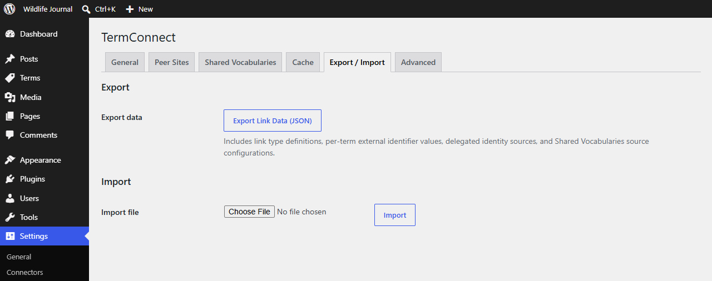

# Export & Import

Go to **Settings&nbsp;→ TermConnect&nbsp;→ Export / Import** to back up and restore configuration.

**Export** downloads a JSON file with all link type definitions, every external link stored across all terms and taxonomies, delegated identity sources with each term's original name and description, and Shared Vocabulary sources. Cached delegated links aren't included, and are refreshed automatically after import. Settings and enabled taxonomies aren't included either, so set those up again when restoring to a new site.

**Import** accepts a previously exported file. Link type definitions are merged (existing slugs updated; new slugs added). Shared Vocabulary sources are merged by source ID (existing IDs updated; new IDs added). If a sync or another change to Shared Vocabularies is running at that moment, the import still restores everything else but skips the sources, and says so; import the file again to add them. Term links and identity sources are restored for any terms whose slugs match between the export and the current site.

